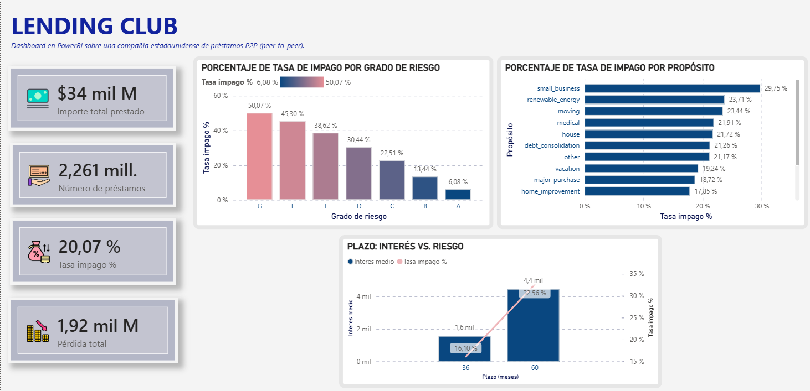

# Análisis de riesgo de crédito — cartera de préstamos (Lending Club)
 
Análisis end-to-end de una cartera de ~2,26 millones de préstamos P2P: ¿qué préstamos acaban en impago, dónde se concentra el riesgo y cuánto dinero expone al prestamista? Desde la carga en base de datos hasta un dashboard interactivo.
 
**Stack:** PostgreSQL · SQL (subconsultas, `FILTER`, agregaciones) · Python (pandas, limpieza y subset) · Power BI (modelo + DAX)
 

 
---
 
## Preguntas del proyecto
 
1. ¿Qué % de préstamos acaba en impago?
2. ¿Sube el riesgo de impago según el grado de riesgo (A→G)?
3. ¿Qué propósitos de préstamo son los más arriesgados?
4. ¿Qué plazo (36 vs 60 meses) es más rentable, y a qué coste de riesgo?
5. ¿Cuánto dinero se pierde en impagos (exposición)?
---
 
## Los datos
 
Dataset público de **Lending Club** (plataforma estadounidense de préstamos P2P), con préstamos concedidos entre 2007 y 2018. El archivo original tiene **~2,26 millones de registros y 145 columnas**.
 
- Del archivo original se seleccionó un **subconjunto de 29 columnas** relevantes para el análisis de riesgo (importe, interés, grado, plazo, ingresos, DTI, propósito, estado y el desenlace del préstamo). Las 116 restantes se descartaron por no aportar al análisis.
- La limpieza (tipos de dato, fechas, `%`, plazo en meses) se hizo en Python y se cargó el resultado en PostgreSQL.
**Decisiones de análisis** (documentadas para dar rigor):
- **Tasa de impago** calculada solo sobre préstamos con desenlace definitivo: `Fully Paid` + `Charged Off`. Se excluyen los `Current` (en curso), cuyo resultado aún no se conoce.
- Se excluyen los estados legacy `Does not meet the credit policy. Status:...` (préstamos antiguos fuera de política).
- El dataset no incluía identificador de préstamo (`id` y `member_id` vacíos), así que se generó una **clave subrogada** (`loan_sk`).
---
 
## Hallazgos
 
### 1. Tasa de impago global: 20,1%
 
**Uno de cada cinco préstamos acaba en impago** (261.655 `Charged Off` sobre 1.303.607 préstamos con desenlace). Es una tasa alta comparada con la banca tradicional, coherente con el modelo P2P: Lending Club prestaba a perfiles que la banca clásica rechazaba, a cambio de tipos de interés más altos.
 
### 2. El riesgo sube de forma monótona con el grado
 
La tasa de impago escala limpiamente del grado A al G:
 
| Grado | Tasa de impago |
|-------|---------------|
| A | 6,1% |
| B | 13,4% |
| C | 22,5% |
| D | 30,4% |
| E | 38,6% |
| F | 45,3% |
| G | 50,1% |
 
Un préstamo de grado G impaga la **mitad** de las veces. El sistema de clasificación de riesgo de Lending Club es coherente: a peor grado, exponencialmente más impago.
 
### 3. `small_business` es el propósito más arriesgado
 
Los préstamos a pequeños negocios lideran el impago (**29,8%**), seguidos de energías renovables y mudanzas. El propósito estrella de la plataforma, `debt_consolidation` (consolidación de deudas), concentra más de la mitad del volumen con un impago del 21,3%.
 
### 4. Plazo: más plazo = más rentable pero más arriesgado
 
| Plazo | Interés medio por préstamo | Tasa de impago |
|-------|---------------------------|---------------|
| 36 meses | 1.557 $ | 16,1% |
| 60 meses | 4.437 $ | 32,6% |
 
Los préstamos a 60 meses generan **casi el triple de intereses** por préstamo, pero **duplican la tasa de impago**. Es el trade-off clásico riesgo-rentabilidad.
 
### 5. Exposición: ~1.900 millones de dólares perdidos
 
La pérdida bruta total de los préstamos impagados (prestado − pagado) asciende a **~$1.900M**, sobre un total prestado de **~$34.000M**.
 
---
 
## Conclusiones y recomendaciones
 
- **El sistema de grados funciona como predictor** — la recomendación no es cambiarlo, sino usarlo para decidir el apetito de riesgo. Endurecer la aprobación en grados **F y G** (impago 45-50%) reduciría pérdidas de forma directa.
- **`small_business` merece criterios de aprobación más estrictos** o un interés acorde a su riesgo real (30% de impago).
- **Revisar la oferta de 60 meses:** el interés extra solo compensa si cubre el doble de impago. Conviene modelar si el margen neto sigue siendo positivo en los grados bajos a 60 meses.
- La baja tasa de recuperación sobre los $1.900M perdidos sugiere que **la palanca está en la prevención (aprobación), no en la recuperación** posterior.
*Nota: el dataset refleja el periodo P2P histórico de Lending Club (2007-2018); la empresa ha pivotado después a banca digital. El análisis es válido como estudio de riesgo de cartera sobre esos datos reales.*
 
---
 
## Estructura del repositorio
 
```
├── sql/            Scripts de creación de tablas y consultas de análisis
├── python/         Script de limpieza y generación del subset
├── powerbi/        Archivo .pbix del dashboard + captura
├── docs/           Diccionario de datos y documentación
└── README.md
```
 
## Cómo reproducirlo
 
1. Descargar el dataset [Lending Club Loan Data](https://www.kaggle.com/datasets/adarshsng/lending-club-loan-data-csv) de Kaggle.
2. Ejecutar el script de Python para generar el subset limpio (`loan_clean.csv`).
3. Crear la base de datos en PostgreSQL y cargar los datos con los scripts de `sql/`.
4. Abrir el `.pbix` de `powerbi/` y actualizar la conexión a la base de datos local.
